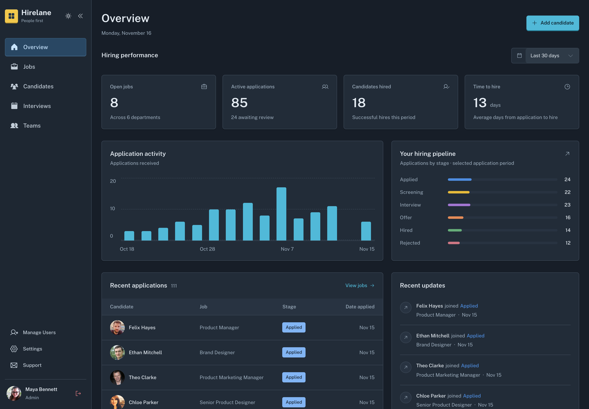
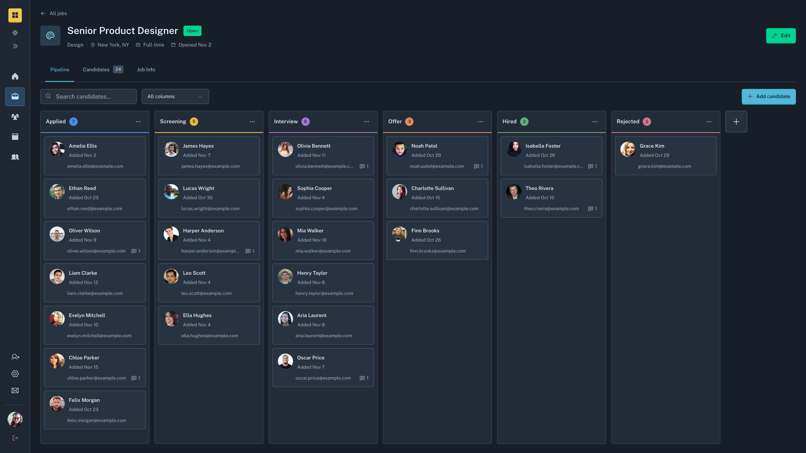
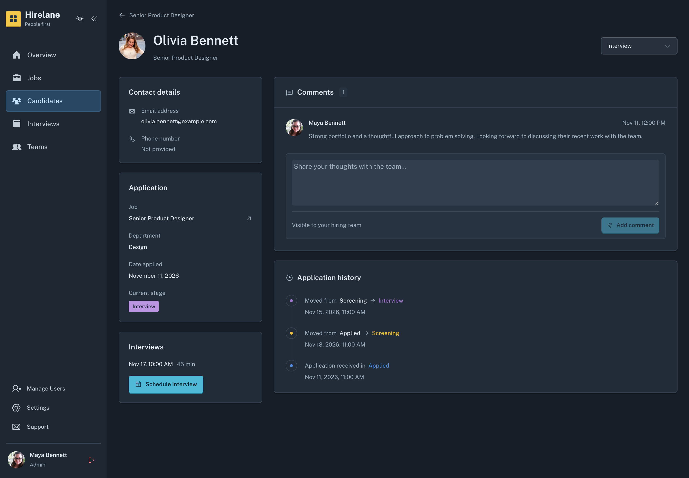
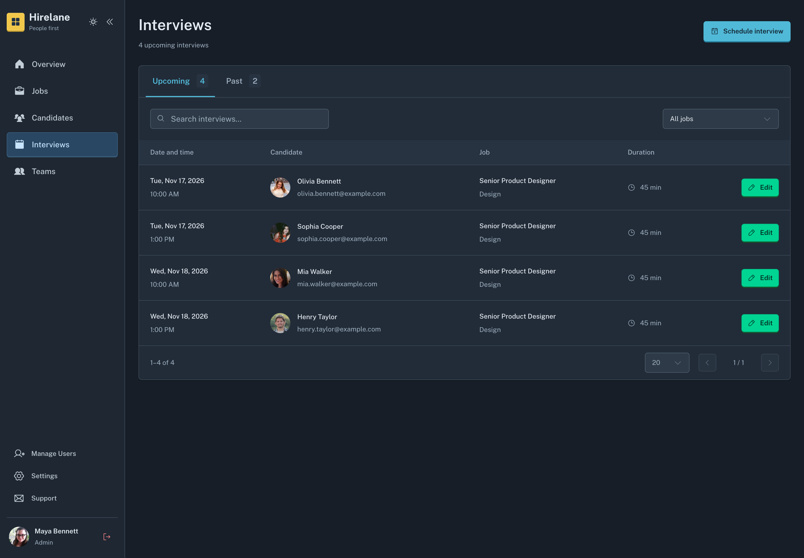
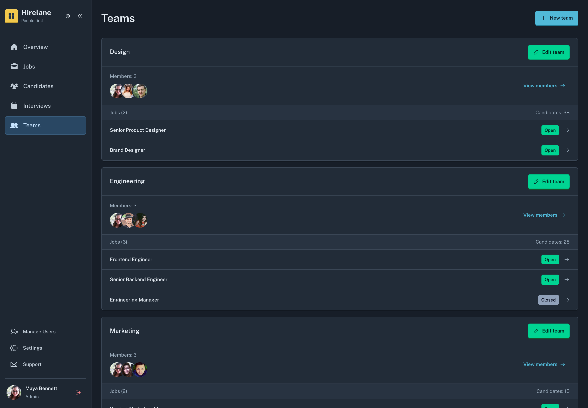
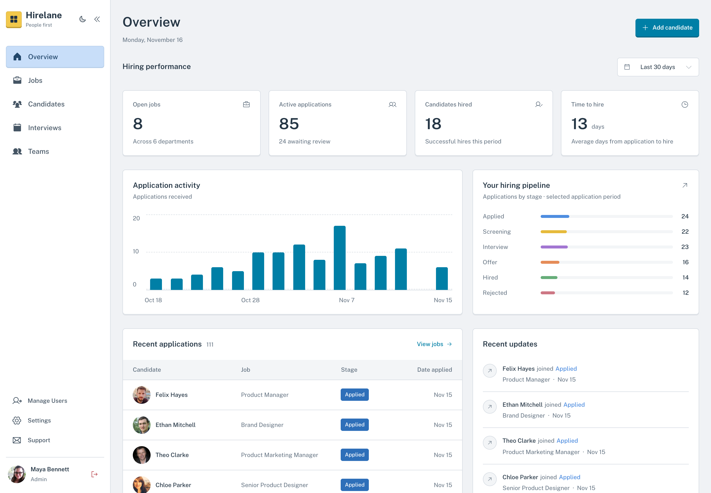

# Hirelane

**People first.** A recruiting workspace that keeps jobs, candidate context and the next interview connected.

 · [Watch walkthrough](artifacts/portfolio/demo.mp4)

## Hiring around the job

Each job has its own pipeline, candidate list and Markdown description. Move applications between stages with drag and drop, adjust the pipeline and open a candidate without losing the job context.

The candidate directory connects applications across jobs. Interview views separate upcoming and past appointments; scheduling checks future times and candidate conflicts. Teams bring members and their assigned jobs together.

| Workflow | Capabilities |
| --- | --- |
| Jobs | Create and edit roles, write Markdown descriptions and manage job-specific stages |
| Pipeline | Drag applications, add or rename stages, and transfer candidates when removing a stage |
| Candidates | Review profiles, applications, comments and stage history |
| Interviews | Schedule and reschedule eligible candidates; browse upcoming and past interviews |
| Teams | Manage membership, assign jobs and transfer ownership between teams |
| Workspace | User directory, light/dark themes and English, Russian or Ukrainian UI |

## The hiring workflow

Job pipeline

Candidate context and interviews

Teams and the light theme

## Technology

Nuxt 4, Vue 3, TypeScript, shadcn-vue, Tailwind CSS, Phosphor and SortableJS. The backend stack is Django REST Framework and PostgreSQL.

## Demo

Interactive demo coming soon.
